<div align="center">

# Nutrivision

**Seu diário alimentar**

Fotografe a refeição, veja os valores nutricionais e acompanhe o dia.
Tudo salvo no aparelho, sem conta e sem internet obrigatória.

</div>

---

## O que o app faz

**Scan.** A partir de uma foto, o app estima calorias, proteína, carboidrato e gordura do prato usando análise de imagem (Google Gemini). Dá para ajustar os valores antes de salvar, ou registrar tudo manualmente se preferir.

**Diário.** Guarda as refeições por dia. Filtra por período (hoje, 7 dias, 30 dias, tudo) e por tipo (café, almoço, jantar, lanche, outro). Cada registro pode ter foto, e a exclusão pede confirmação.

**Progresso.** Mostra a evolução do peso num gráfico de linha, a média diária de macros contra as metas, o histórico por dia e um insight curto sobre o período. Exporta tudo em CSV.

**Água e peso.** Contador de água do dia na Home e no Perfil, e registro de peso por dia com atualização do IMC.

**Pratos fixados.** Marque um prato favorito e adicione ao dia em um toque, sem escanear de novo.

**Personalizar prato.** Monte um prato com nome, refeição e macros, veja a prévia e salve no diário ou guarde na tela inicial para reutilizar.

**Perfil.** Metas diárias, nome e dados físicos, objetivo, nível de atividade, intolerâncias, alergias e condições de saúde. O app usa isso para gerar avisos personalizados ("Atenção para você") no resultado do scan.

## Privacidade e dados

- Sem conta e sem login. Nada vai para a nuvem.
- Registros em JSON dentro da pasta privada do app (`.relatorio/`).
- Fotos ficam no armazenamento privado do aplicativo.
- A chave da API Gemini é opcional: pode ser colada no Perfil (fica só no aparelho) ou definida em `local.properties`.

## Design

Estética neobrutalista híbrida: base limpa com bordas pretas, sombra dura sem desfoque e verde como destaque. Tipografia Archivo (títulos), Inter Tight (corpo) e Space Mono (números).

## Tecnologias

Kotlin · Jetpack Compose · minSdk 24 / targetSdk 34 · Coil · Retrofit/OkHttp · Gson · Navigation Compose

## Como compilar

```bash
# APK de debug
./gradlew :app:assembleDebug

# Instalar no aparelho conectado
adb install -r app/build/outputs/apk/debug/app-debug.apk

# Testes unitários
./gradlew :app:testDebugUnitTest

# Testes instrumentados (emulador)
ANDROID_SERIAL=emulator-5554 ./gradlew :app:connectedDebugAndroidTest
```

No Xiaomi/MIUI, ative em Opções do desenvolvedor: **Instalar via USB** e **Depuração USB (Configurações de segurança)**.

---

## Telas

<table>
  <tr>
    <td align="center">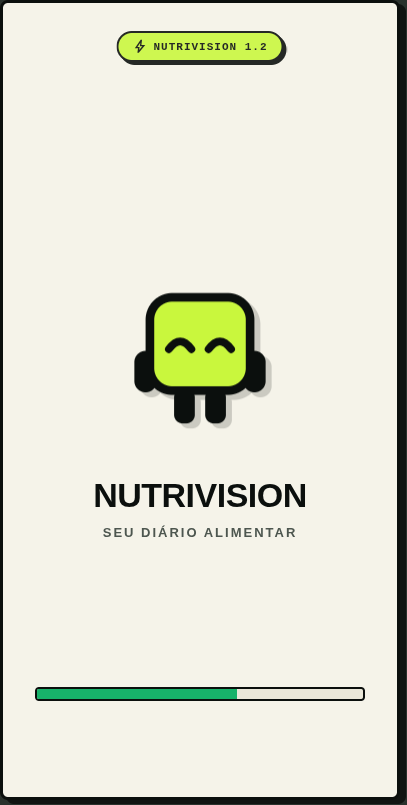<br><sub><b>Abertura</b></sub></td>
    <td align="center">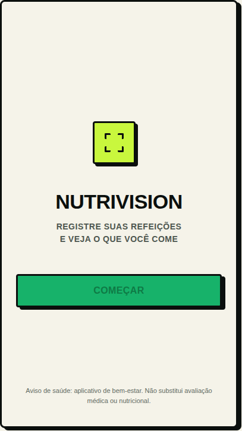<br><sub><b>Login</b></sub></td>
    <td align="center">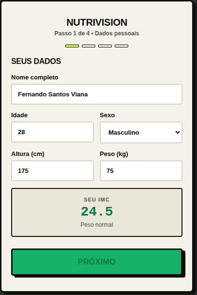<br><sub><b>Onboarding</b></sub></td>
  </tr>
  <tr>
    <td align="center">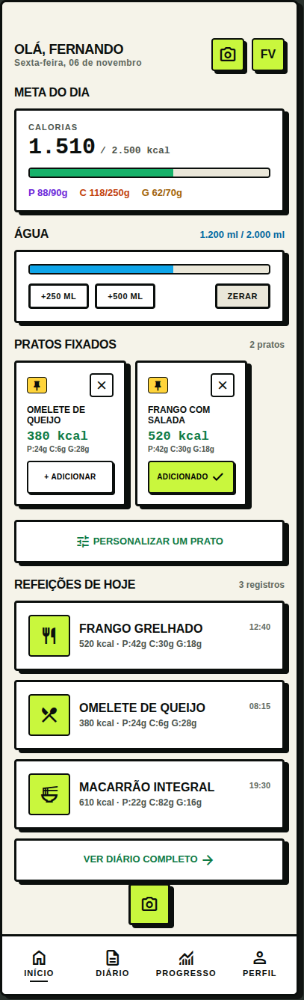<br><sub><b>Home</b></sub></td>
    <td align="center">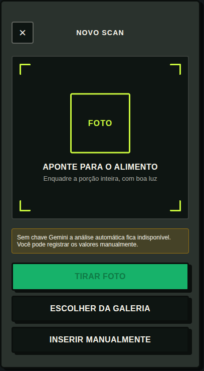<br><sub><b>Scan</b></sub></td>
    <td align="center">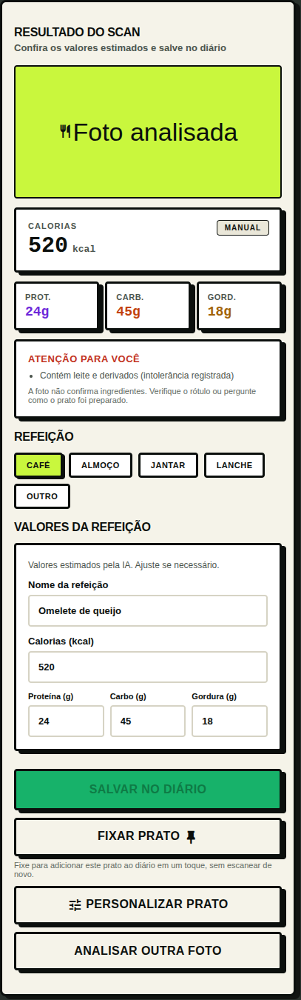<br><sub><b>Resultado</b></sub></td>
  </tr>
  <tr>
    <td align="center">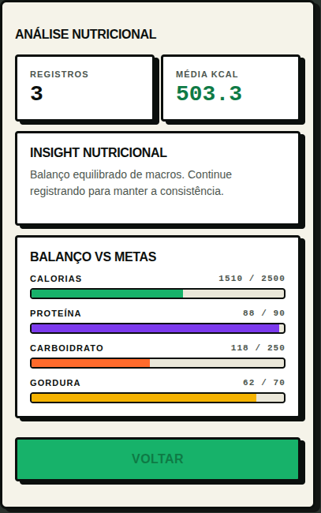<br><sub><b>Análise</b></sub></td>
    <td align="center">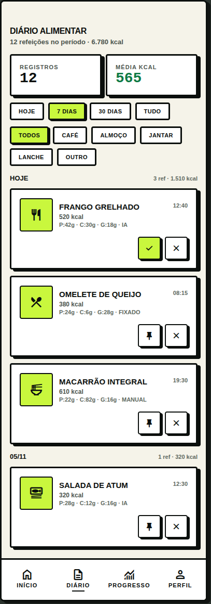<br><sub><b>Diário</b></sub></td>
    <td align="center">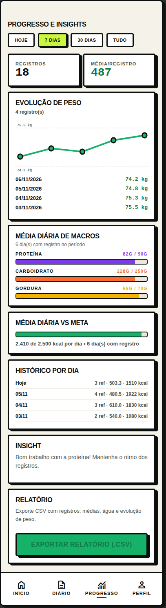<br><sub><b>Progresso</b></sub></td>
  </tr>
  <tr>
    <td align="center">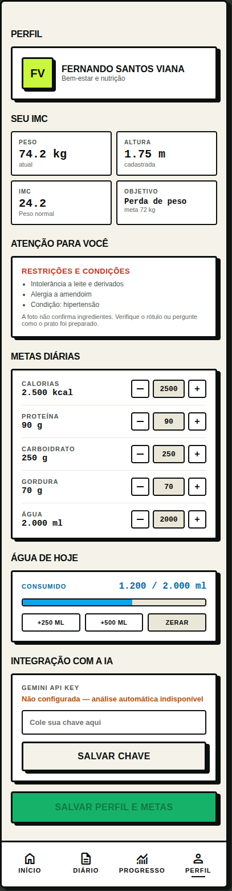<br><sub><b>Perfil</b></sub></td>
    <td align="center">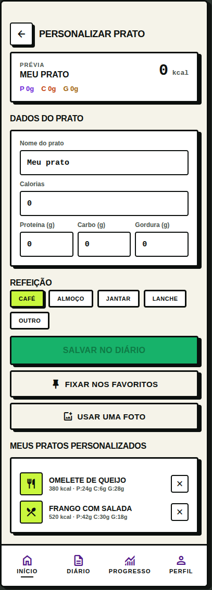<br><sub><b>Personalizar prato</b></sub></td>
    <td></td>
  </tr>
</table>

> Protótipo navegável (HTML): [`doc/mockups/index.html`](doc/mockups/index.html)

---

## Mascote

<div align="center">
  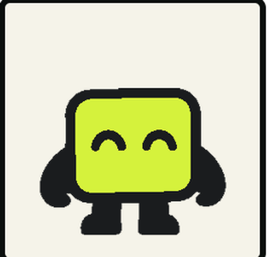
</div>

O Nutrivision tem um mascote: um quadradinho verde-limão que aparece na Home e reage ao seu dia. Ele fica animado quando você está no ritmo da meta e cobra atenção quando não há registro. A ideia é deixar o acompanhamento mais leve do que uma lista fria de números.
